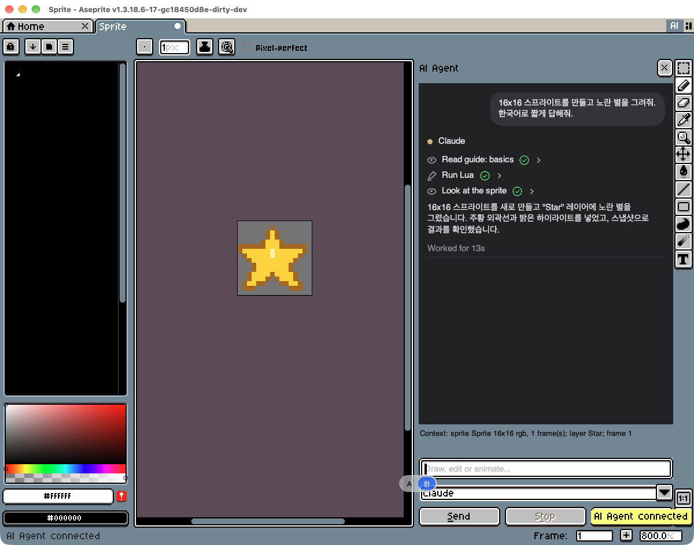
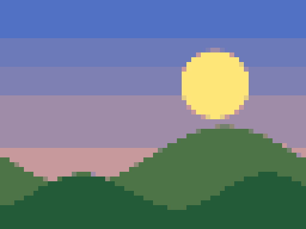
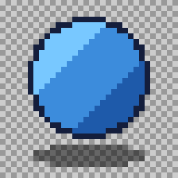
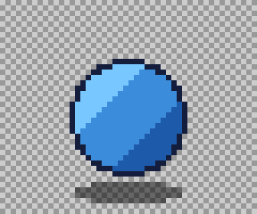

# Aseprite Agent

Control [Aseprite](https://www.aseprite.org/) with natural language through your local coding agent — [Claude Code](https://claude.com/claude-code) or [Codex CLI](https://github.com/openai/codex) — using your own subscription.

> "Make a layer called Shadow under Body."
> "Turn this PNG into 32×32 pixel art with 16 colors."
> "Change this animation from 10 frames to 20."
> "Open the palette editor and switch to the bucket tool."

The agent does not generate images with a diffusion model. It drives Aseprite itself: it calls any of Aseprite's built-in commands, uses its tools, edits layers, frames, cels, tags and pixels through the Lua API, and looks at snapshots to check its work.

**Status:** early development. See [docs/PLAN.md](docs/PLAN.md).

This directory lives inside a fork of Aseprite. The rest of the repository is Aseprite's own source, under its [EULA](../EULA.txt).

## How it works

```
Claude Code / Codex CLI
        │  MCP (stdio)
        ▼
agent/bridge/  (Node, MCP server)   ── ws://127.0.0.1, per-session token
        │  WebSocket
        ▼
agent/extension/  (Aseprite Lua extension)
  runs each request inside app.transaction → one undo step
```

## Repository layout

| Path | Contents |
|---|---|
| `agent/extension/` | Aseprite extension (Lua). Connects to the bridge and executes requests. |
| `agent/bridge/` | MCP server that Claude Code or Codex connects to. |
| `agent/docs/` | Plan and agent instructions. |

## Requirements

- Aseprite 1.3 or later: build this fork from source for personal use (see [INSTALL.md](../INSTALL.md)), or use a purchased copy with the extension only. Never redistribute compiled binaries.
- Node.js 20 or later.
- Claude Code or Codex CLI.

## Chat panel inside Aseprite

Click the **AI** button at the top right (left of the workspace layout button), or use **File > Scripts > AI Agent > Toggle Chat Panel**. In this fork the panel docks next to the canvas (see [docs/native-panel.md](docs/native-panel.md)); in stock Aseprite it floats.

Your messages appear as bubbles on the right. Each agent turn shows its steps the way Claude Code does: "Thought for 3s", one row per tool call with a check mark when it succeeds, the reply, and "Worked for 14s". Click a row to see the tool's input and output; an edit step also shows Before, After and changed-pixel thumbnails of the active frame. The input box wraps and grows up to five lines; **Enter** sends and **Shift+Enter** adds a line. Text uses the system font, and Korean and other input methods compose normally. For sharp text, use Screen Scaling 100% with UI Elements Scaling 200% (see [INSTALL.md](docs/INSTALL.md#troubleshooting)).

Choose `claude` or `codex`; the bridge runs that agent with your own login over the [Agent Client Protocol](https://agentclientprotocol.com) (`claude-agent-acp`, `codex-acp`, installed with the bridge) and keeps the conversation going until you click **New chat**. **Stop** cancels the turn and the next message continues the same conversation. When the agent makes a plan, the panel shows it as a checklist; when it asks permission for a tool, the panel asks you. In Agent mode both agents also have a shell for work outside the document (files, converters, git): Claude asks you before any command that changes something (read-only ones like `ls` run on their own), and Codex runs commands in its sandbox with its own approval review. Ask and Plan modes have no shell (Codex's sandbox is read-only there). Set `ASEPRITE_AGENT_RUNTIME=stream` to use the older `claude -p` / `codex exec` runtime. Every message includes what you have selected (layer, frame, timeline range, pixel selection), so "this layer" and "the selected frames" work.

The agent puts what it draws on a new `AI: <task>` layer above your layer, with your request saved on it, so your pixels stay untouched unless you ask to edit a layer in place. Ask for variations ("give me 3 swords") and the panel shows a thumbnail of each: click one to keep it as an `AI:` layer, or **Discard** them all. Each choice is one undo step.

When the agent does something you want again, ask it to "save this as a command called outline-dark". Saved commands appear in **File > Scripts > AI Agent > My Commands** and run without the agent; in the chat, `/outline-dark width=2` runs one directly (type `/` to list them). **Manage My Commands...** runs, disables, shows the source of, or reverts a command to its previous version. Commands live in `~/.aseprite-agent/commands`, a git repository with one commit per change.

Type `/` in the chat to search skills (a bare `/` lists them grouped by category): built-in ones (3D model to pixel sprites, voxels to isometric sprites, pixel text and UI, export for a game engine, normal maps and lighting, recolor and team colors, dithering, make a terrain tileset, make 4 or 8 directions, animate, shade and outline, recreate from a reference image, concept first (prompt an image model, then draw to its storyboard), import a sprite sheet, fix AI or upscaled pixel art, extract palette, match tone and palette, check and fix pixel art, review with fresh eyes, retime an animation, variations, work on many frames at once, pixel FX: effects timed to an attack with hit-stop) and your own, plus your saved commands. Typing filters the list; Up and Down move the highlight, and Enter, Tab or a click picks it (Escape closes the list). The picked skill shows as a chip above the prompt, which stays free for your request; ✕ or Backspace in an empty prompt removes it, and the chip goes with your next message. The reply's header names the skill.
Type `/` in the chat to search skills (a bare `/` lists them grouped by category): built-in ones (brief before drawing, from request to finished asset (studio), 3D model to pixel sprites, voxels to isometric sprites, pixel text and UI, export for a game engine, normal maps and lighting, recolor and team colors, dithering, make a terrain tileset, make 4 or 8 directions, animate, shade and outline, recreate from a reference image, import a sprite sheet, fix AI or upscaled pixel art, extract palette, match tone and palette, check and fix pixel art, review with fresh eyes, retime an animation, variations, work on many frames at once, pixel FX: effects timed to an attack with hit-stop) and your own, plus your saved commands. Typing filters the list; Up and Down move the highlight, and Enter, Tab or a click picks it (Escape closes the list). The picked skill shows as a chip above the prompt, which stays free for your request; ✕ or Backspace in an empty prompt removes it, and the chip goes with your next message. The reply's header names the skill.

Teach the agent your own techniques with skills: markdown files in `~/.aseprite-agent/skills/` (`<name>.md`, or a `<name>/SKILL.md` folder like the built-ins) (**File > Scripts > AI Agent > New Skill...** creates one from a template). A skill can list trigger words in its frontmatter; when a message contains one, the skill goes along with it. Type `/skill:name your request` to use a skill explicitly. A skill named like a built-in guide topic (`basics`, `recipes`, `pixel-art`) replaces it for the agent. Built-in and user skills are also MCP prompts and `skill://<name>` resources for any MCP client ([docs/mcp-clients.md](docs/mcp-clients.md)).

The agent also has a pixel-art knowledge base in [guide/rules/](guide/rules/): six chapters (animation timing, characters at small sizes, tiles, isometric, effects, UI) with numeric tables, common mistakes, review lists and grid templates it can write with `write_pixels`. They are read on demand (`read_guide("rules/animation")`, or the MCP resource `rules://animation`), never added to every prompt; skills cite them by id (`rule:anim.timing.walk`). Adapted from [aseprite-ai-artist](https://github.com/with-pebbly/aseprite-ai-artist) (MIT, see [guide/rules/CREDITS.md](guide/rules/CREDITS.md)).

For new characters and animations, the **concept** skill (`/skill:concept`) designs before it draws: it writes an art spec and a paste-ready prompt for any image model (a concept sheet or a storyboard with its panel layout spelled out), and you either attach the image it makes or continue without one. The image becomes a pixel spec stored on the sprite and, for a storyboard, reference frames on a locked layer; the agent draws over them and fixes the few largest mismatches that `mismatch_regions` finds. Adapted from aseprite-ai-artist's concept skill (MIT).

For sizable work, the **review** skill (`/skill:review`) has the art judged by a critic that never saw the brief: `critique` starts a fresh agent of the same provider on a read-only endpoint with only the images, the sprite state, the rules index and a one-line "what this is", and it answers with a cold read, a score and findings that cite rules. Below 7/10 or with a BLOCKING finding, the skill runs at most three small fix rounds: a `diff_visual` checkpoint, a fix that may change at most 25% of a layer's opaque pixels, and a blind `ab_compare` that keeps the fix only when a second fresh critic prefers it. Adapted from aseprite-ai-artist's pixel-critic and studio skill (MIT).

For a request that spans several steps ("make a 32x32 knight with a walk cycle for Godot"), the **studio** skill (`/skill:studio`) runs the chain: the **brief** skill first states six decisions in one message (size, palette, view, light, outline, destination) and asks only what truly blocks it; the chain of skills becomes the turn's plan; each skill is read when its stage starts; then a review, the export, and a closing report of what was cut or approximated and why. Every skill ends with a "Then:" line naming the usual next skill. Adapted from aseprite-ai-artist's brief and studio skills (MIT).

```markdown
---
name: dithering
description: Ordered dithering for 16-color sprites
triggers: [dither, gradient, shading]
---
Use a 2x2 Bayer pattern. Never dither single pixels.
```

Pick a mode next to the agent: **Agent** (default) makes changes; **Ask** only answers and advises; **Plan** replies with a numbered plan and an **Apply plan** button that carries it out in Agent mode. Ask and Plan runs connect to a read-only tool endpoint, so the agent cannot change the document. The panel remembers the mode.

**Developer** mode (asks once before the first use) lets the agent change this Aseprite fork itself: it works in a git worktree of its own (your checkout stays as it is) with its coding tools, asks you before edits and commands, and commits on a `dev/<date>-<task>` branch. Its reply gets **Rebuild & Relaunch**: your branch is fast-forwarded to the agent's commits (only when your checkout has no uncommitted changes to tracked files), Aseprite is rebuilt when C++ changed (build errors go back to the agent to fix) and restarted with your open sprites and the conversation; **Discard** removes the agent's worktree (uncommitted work goes into a stash) and undoes an apply if nothing changed since. Builds of the fork are for your own use only (Aseprite EULA).

To show the agent something, click **+** and attach the selection, the active layer, the active frame, the clipboard image (a screenshot, a copied reference) or an image file (for example a reference whose palette or style you want). **File > Scripts > AI Agent** and the timeline's cel, layer and frame context menus have **Attach to AI Chat** too. Each open sprite has its own chats, shown as tabs at the top of the panel: switching file tabs switches chats, **New chat** (or **+**) adds another chat for the sprite, and ✕ closes one. One chat's turn runs at a time; a message for another chat waits until it ends. If you switch to another file while a chat works, its edits wait ("Waiting for its sprite's tab") and continue when you come back, so they never land on the wrong sprite. While the agent works, a message you send waits in a queue under the reply and goes when the turn ends; **Send now** on a queued message stops the turn and sends it next, and **Stop** pauses the queue. Cmd+V (Ctrl+V) in the prompt attaches the clipboard image. Attachments show as small cards above the input (✕ removes one) and go with your next message as images; rendered ones are saved in `~/.aseprite-agent/attachments` and deleted after a week.

To turn an animated file into frames as it is, pick **+ > Import animation as frames...**: a new sprite, or a new layer of the open sprite from a frame you choose, with the file's own frame times. You can also attach the file and ask the agent to do it (`import_animation`).

Any file Aseprite opens can be attached: PNG, JPEG, GIF, WebP, BMP, TGA, PCX, QOI, ICO, PSD, FLI/FLC and `.aseprite`. PNG, JPEG, WebP and still GIF go to the model as they are. The bridge converts the rest with Aseprite: an animation (animated GIF or WebP, APNG, a multi-frame `.aseprite`) becomes one sheet of numbered frames with their durations; small pixel art is scaled up so the model sees each pixel, and very large images are scaled down.



If no agent session is running, the panel starts a background bridge (`node agent/bridge/dist/index.js --daemon`) on the first message. Aseprite learns the bridge's location the first time any bridge connects, so run `claude` once from this repository first. Other scripts can use it too: `AsepriteAgent.chat("make it blue")`.

The panel's agent can only use the Aseprite tools: Claude runs with no built-in tools and only `mcp__aseprite` allowed, and Codex gets only the `aseprite` MCP server with its tools pre-approved.

## Demos

Produced by [demos/run_demos.mjs](demos/run_demos.mjs), which calls the same MCP tools an agent uses, against a live Aseprite.

| Request | Result |
|---|---|
| "Turn this image into 64×48 pixel art with 12 colors" ([source](demos/output/source.png)) |  |
| "Make a blue ball on a layer called Body, and add a 50% Shadow layer under it" |  |
| "Add 8 px of canvas on the left, right and top" |  |
| "Make a 6-frame idle bob, tag it `idle`, export a GIF" |  |
| "Double the frames (6 → 12) without changing the speed" | 12 frames, still 0.72 s per loop |
| "Export a sprite sheet with JSON" | [6-sheet.png](demos/output/6-sheet.png) + [6-sheet.json](demos/output/6-sheet.json) |
| "Show the grid and onion skin" | UI commands run through `run_command` |

## Setup

1. Install the extension and connect your agent: see [docs/INSTALL.md](docs/INSTALL.md). To build this fork of Aseprite yourself, see [docs/BUILD-macos.md](docs/BUILD-macos.md).
2. Connect your agent.
   - **Claude Code, any folder:** install the plugin (tools, the guide as skills, and two hooks: at session start it says whether Aseprite is connected, and after the first edit it reminds the agent to look at the result; see [claude-plugin/](claude-plugin/)):
     ```
     /plugin install aseprite --marketplace codeyoma/aseprite
     ```
   - **Claude Code, this repository:** the repository root has a `.mcp.json` that starts the bridge. Run `claude` from the repository root and approve the `aseprite` server. Or add it by hand:
     ```bash
     claude mcp add aseprite -- node /path/to/aseprite/agent/bridge/dist/index.js
     ```
   - **Codex:** add to `~/.codex/config.toml`:
     ```toml
     [mcp_servers.aseprite]
     command = "node"
     args = ["/path/to/aseprite/agent/bridge/dist/index.js"]
     ```
   - **Cursor, VS Code, Claude Desktop and other MCP clients:** see [docs/mcp-clients.md](docs/mcp-clients.md). The skills come along as MCP prompts (`animate`, `pixel-fx`, ...; an optional `request` argument is your request) and as `skill://<name>` resources, so no plugin is needed.
3. Open Aseprite. The extension connects to the bridge automatically (File > Scripts > AI Agent > Connect / Disconnect).
4. Ask: "Make a 32×32 sprite with a red circle on a layer called Body."

## Command line

`ase` (the bridge package's second command) uses the same tools from a shell. Live commands talk to the running Aseprite; `check` and `render` on a file run Aseprite headless.

```bash
ase state --json
ase snapshot --frame 3 -o frame3.png
ase run -e 'return #app.sprite.layers'
ase timeline
ase check hero.aseprite          # exits 1 when there are errors
ase render hero.aseprite --sheet hero.png --data hero.json
```

Batch work on files, with no window: `--headless` (or `ASEPRITE_AGENT_MODE=headless`) runs `state`, `snapshot`, `check` and `timeline` over many files in one long-lived headless Aseprite, about 5x faster than one `aseprite -b` per file. It is only used when asked for, never because the window is missing, and it refuses a file the running Aseprite has open.

```bash
ase --headless snapshot sprites/*.aseprite -o previews/
ase --headless check sprites/*.aseprite --json
```

Every command takes `--json`. Failures print `✗ <problem>` and `Fix: <what to do>` and exit 1. Set `ASEPRITE_BIN` if `aseprite` isn't on PATH.

## Tools

| Tool | What it does |
|---|---|
| `get_state` | Open sprites; layers, frames, tags, palette, selection, active tool and colors |
| `get_context` | What the user selected: active layer/frame/cel, timeline range, pixel selection, tool and brush |
| `execute_lua` | Runs Lua in Aseprite as one undo step; rolls back on error |
| `run_command` | Runs any of Aseprite's built-in commands with parameters (dialogs skipped by default) |
| `list_commands` | Finds commands and their parameters, generated from this fork's source |
| `snapshot` | PNG of the sprite or a layer, upscaled so pixels are visible; review views: `filmstrip` (a tag's or a range's frames in one numbered image), `onion` (a frame over its neighbors, earlier ones ghosted red, later ones blue) and `compare` (a reference layer beside the art) |
| `read_pixels` | A region as a text grid with a color legend |
| `write_pixels` | Writes a grid in `read_pixels`' format back into a layer in one undo step; ragged rows and unknown keys are refused with their row and column |
| `save_command` / `run_saved_command` / `list_saved_commands` / `delete_saved_command` | Keep Lua the agent wrote as a command in **My Commands**, versioned with git |
| `get_timeline_text` / `apply_timeline_text` | The timeline (frames, durations, tags, linked cels) as editable text, applied in one undo step or previewed as a plan |
| `palette_from_image` | Colors of an image, layer, selection or the sprite: counts, ramps, near-duplicates, closest available palettes; set, swatch or save as `.gpl`; saves .gpl, .hex, .pal, .act, .col or .aseprite palettes |
| `color_stats` / `adjust_tone` / `remap_to_palette` | Compare tone in plain words, shift or match lightness/saturation/contrast, or limit colors to a palette (ramps keep their order); palettes by name or alias (`Game Boy`, `endesga-64`, `lospec:<slug>`) |
| `list_palettes` | The palettes available by name: yours, Aseprite's and Lospec ones already fetched (with author and URL), the aliases and the resolution order. Any Lospec palette works by its slug: fetched once from Lospec's palette API, cached in `~/.aseprite-agent/palettes/lospec`, and credited in the results that use it |
| `detect_pixel_grid` / `fix_pixel_art` | Find the pixel grid of upscaled or AI-generated "pixel art" (fractional cells too) and rebuild it as a native-size sprite with a clean palette |
| `import_animation` | Turns an animated file (GIF, WebP, APNG, .aseprite, FLI) into frames with its own timing: a new sprite with the file's colors as palette, or a new layer of the open sprite from a frame on, adding frames as needed |
| `import_sheet` | Slices a sprite sheet into an animated sprite: a grid (cell size found from the gutters), loose sprites on a background, or an atlas (Aseprite or TexturePacker JSON, TexturePacker XML, Godot SpriteFrames .tres); rows can become tags |
| `recreate_from_reference` / `style_summary` / `split_by_color` / `detect_background` / `find_sprites` | Rebuild an attached screenshot or sprite as an editable sprite (native pixels, palette, frames, layers by color role), and describe a style with rules for drawing new art like it; find the background (key color, transparent, checkerboard) and cut the sprites out of a screenshot or loose sheet as frames or layers |
| `make_ramp` / `shade_sprite` / `outline_sprite` / `anti_alias` / `ambient_occlusion` | Hue-shifted color ramps; shade flat colors from a light direction onto an `AI: shaded <layer>` layer; outer/inner outlines in one color, the darkest, or selout; manual anti-aliasing of jagged steps with in-between palette colors, and ambient occlusion in creases from a bevel or a height layer |
| `transform_layer` / `rotate_layer` / `squash_stretch` / `smear_frame` / `subpixel_move` | Animate rigid parts along eased arcs, rotate cleanly (RotSprite), squash and stretch on the ground line, smear fast moves — no new colors; sub-pixel motion that shifts edge shades instead of jumping a pixel |
| `direction_plan` / `mirror_direction` / `iso_project` / `iso_grid` | Plan 4/8 directions from tags, mirror E↔W/NE↔NW/SE↔SW (keeping asymmetric layers), project top-down tiles to 2:1 isometric, add an isometric guide |
| `make_autotile` / `seamless_check` / `make_seamless` | Build a 47-tile blob or 16-tile autotile set from a 5-tile row or a 6-tile (2x3, RPG Maker) template, preview it on a tilemap layer, export Godot 4 `.tres`, Tiled `.tsx` and JSON; check how a tile wraps and fix small seams |
| `dither_gradient` / `dither_to_palette` / `palette_swap` / `export_palette_lut` | Ordered-dithered gradients in palette colors, dither smooth shading to a palette, recolored variants that keep the shading, and index map + LUT + shader for palette swaps in games |
| `normal_map` / `light_preview` / `export_normal_sheet` / `make_masks` | Normal maps for 2D lights (bevel, luminance or a painted height layer; OpenGL or DirectX), a lit preview, and matching color and `_n` sheets; emission and specular masks on hidden layers, used by the preview and exported as `_e`/`_s` sheets |
| `export_for_engine` | Sheet + metadata for Godot (SpriteFrames), Unity (sliced .meta), Phaser/PixiJS, Tiled or JSON, with trim, padding, extrusion, scale, power-of-two, normal maps and import notes; 9-patch slices go to the JSON, Unity sprite borders and a Godot NinePatchRect scene. Effects from the FX tools: `meta.fx` in the JSON (`fps`, `loop`, `windup` ms to the impact, `origin`, `hits: [{ frame, freeze_ms }]` for hit-stop); a sprite of effects only is pivoted on the effect's origin unless `pivot` is given (written on each JSON frame, which Phaser reads); `glow: "sheet"` (default when there are light layers: not Normal blend, or `AI: fx … glow`) writes them to `<name>_glow.png` with the color sheet's layout (`meta.glow`, a Godot `<name>_glow.tres`) and leaves them out of the color sheet, `glow: "baked"` composites them in |
| `draw_text` / `make_ui` | Pixel-exact text in Aseprite's own fonts, a BMFont, a TTF/OTF file or an installed font (outline, shadow, scale), and UI panels or buttons with normal/hover/pressed/disabled frames and 9-patch slices, in the sprite's palette |
| `render_voxels` / `layers_to_voxels` | MagicaVoxel `.vox` models, or a sprite's layers stacked as height slices, rendered as pixel-exact isometric sprites in 4 tagged directions |
| `render_model` | A `.glb`, `.gltf` or `.obj` model rendered into pixel-art sprites: orthographic camera at a preset elevation, 1/4/8/16 tagged directions, toon bands, outline, palette snapping, and glTF node animations sampled into frames (skinned meshes render in their bind pose) |
| `list_fx` / `preview_fx` / `add_fx` / `new_fx_sprite` | A library of game effects as pixel art (hits, slashes, explosions, lightning, arcane, holy, fire): list them, preview one as a numbered contact sheet, add one to the sprite at a point or slice in one undo step (`anchor`: the point is the effect's visual centre, or its ground point for fires, pillars and explosions; timed by the sprite's frame durations, frames added when it runs longer, glow on an Addition layer, its colors added to the sprite palette), or make one its own tagged sprite |
| `fx_from_recipe` | A new effect from a JSON recipe instead of code: size, origin, fps, duration, loop, seed, a palette ramp and phases (charge, flash, burst, linger, decay) of particle emitters (the engine's 12 kinds), lights, rings, floor bands and shapes, checked by a schema that lists every problem. `apply`: `preview` (a contact sheet), `layer` (as `add_fx`, one undo step) or `sprite` (as `new_fx_sprite`); the FX record's id is `recipe:<name>` and the recipe is stored on the layer to tune later. Loops wrap exactly |
| `check_fx` | Checks effect layers (one, or every layer with an FX record or an `AI: fx` name), with coordinates and a fix: pixels outside the sprite or past the effect's canvas (re-rendered from the FX record), a one-shot that still draws at its duration, a loop whose last frame jumps back to its first, and more colors than `max_colors` (24) |
| `fx_overlay` / `hit_stop` | An effect timed onto a character's animation (a tag or frames from a start frame), its impact on a chosen frame, placed at a point or at a layer's centre or feet: resampled at the sprite's frame times, or retimed to the effect's fps by inserting frames whose character cels are linked (tags grow); and a hit-stop that holds the contact frame exactly `freeze_ms` longer, optionally spending part of it on a decaying sideways shake and flashing a layer white, recorded on the sprite for export. One undo step each |
| `critique` | A fresh critic agent that never saw the conversation or the brief judges the sprite: a cold read, a score out of 10 and BLOCKING / WORTH FIXING / NOTE findings, each citing a rule id (unknown ids are flagged). Ships at 7/10 with nothing BLOCKING. With `checkpoint`, a fix that changed more than 25% of a layer's opaque pixels is refused first |
| `ab_compare` | Blind A/B: a fresh critic sees two versions (a `diff_visual` checkpoint and the canvas now, or two layers/frames) labelled A and B in a random order only the bridge knows, picks one, and the answer is mapped back. With a checkpoint the 25% fix guard runs first |
| `concept_spec` / `pixel_spec` | A concept sheet or storyboard from an image model read into a pixel spec skeleton (JSON) for the target canvas: panels cut by a grid or by counting figures, each panel's silhouette measured in target pixels (bounds, center, top, feet), dominant colors with guessed roles; the agent fills in poses, landmarks and deliberate deviations and stores the spec on the sprite (`pixel_spec`, read back without arguments) |
| `storyboard_to_frames` / `mismatch_regions` | A storyboard's panels scaled to the canvas (pixel snap or nearest) onto frame i of a hidden or faint, locked `AI: Reference` layer, frames added as needed, in one undo step; then the largest areas where the drawing and the reference differ by silhouette (missing or extra, with frame and bounds), with each frame's overlap and center offset |
| `spawn_agents` | Splits a multi-frame job across up to 4 sub-agents running in parallel, each limited to its frames (and layers) |
| `propose_variations` | Shows the user the candidates the agent built (`variationLayer`) as thumbnails to keep one or discard |
| `diff_visual` | What changed on the active frame since the last edit step or a saved checkpoint: PNG with changed pixels in red, and the changed bounds (x, y, w, h) and pixel count in text |
| `check` | Pixel-art checks (off-palette, orphans, semi-transparent, empty cels, frame timing, outside canvas, duplicate frames, ground jitter) with fixes; `expect` adds stated expectations: which frames a layer has art in (`layer_frames`) and layer pairs that must never cross (`must_not_overlap`, e.g. a blade through the face) |
| `list_skills` | Search the skill catalog (built-in and your own) by name, category or trigger |
| `read_guide` | Agent guide: `basics`, `recipes`, `pixel-art` (in [guide/](guide/)), plus your own skills; the pixel-art rules: `rules` (index), `rules/<chapter>`, or one rule id such as `anim.timing.walk` |
| `undo` / `redo` | Steps back and forward through the history |

A small FX recipe (`fx_from_recipe`; positions are px from the origin, y down; colors are palette steps, 0 darkest and -1 brightest):

```json
{ "name": "blue-burst", "size": [96, 96], "origin": [48, 48], "duration": 0.6,
  "palette": ["#10162e", "#2a4a8c", "#4f8fe0", "#9fd4ff", "#ffffff"],
  "phases": [
    { "name": "flash", "start": 0, "end": 0.1, "shapes": [{ "type": "disc", "radius": [6, 2], "color": -1 }] },
    { "name": "burst", "start": 0, "end": 0.4,
      "emitters": [{ "kind": "spark", "count": 16, "speed": [80, 160], "life": [0.2, 0.35] }],
      "rings": [{ "radius": [3, 22], "width": [3, 1], "color": "cool" }],
      "lights": [{ "radius": 24, "strength": 0.6, "life": 0.25 }] } ] }
```

Several agent sessions can run at once. The newest bridge takes over Aseprite; when it exits, the previous one takes it back.

## Security

`execute_lua` runs arbitrary Lua inside Aseprite, which can read and write files. The bridge listens on `127.0.0.1` only and requires a token. Keep Aseprite's script security prompts enabled.

## License

The code under `agent/` is MIT-licensed (see [LICENSE](LICENSE)). Everything else in this repository is Aseprite source under its EULA. Aseprite is a trademark of Igara Studio S.A. and is distributed under its own [EULA](https://github.com/aseprite/aseprite/blob/main/EULA.txt). This project is not affiliated with Igara Studio.
